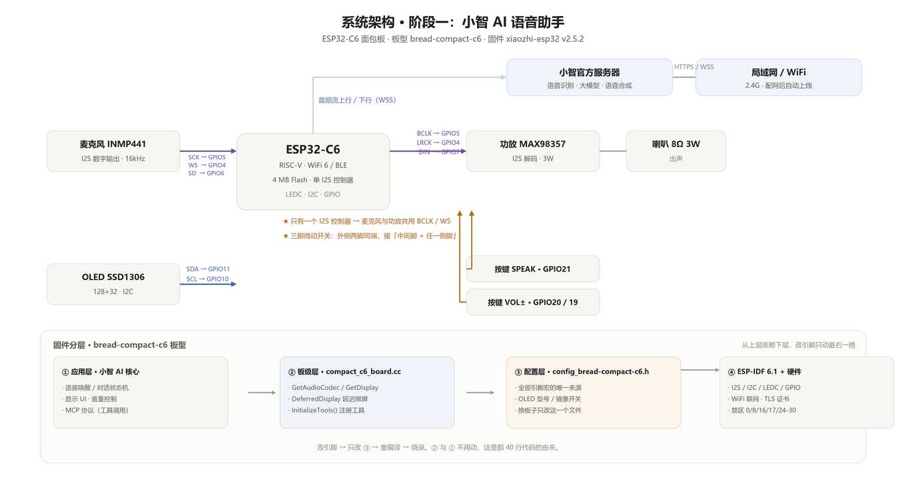

# ESP32-C6 小智 AI —— OLED 版固件与工具集

> 小智（xiaozhi）AI 语音助手在 **ESP32-C6** 上的定制固件工程 —— 阶段一：OLED 点亮 + 语音交互。

## 这是什么

本仓库是 `xiaozhi_xiage` 项目的**第一阶段**成果：在 ESP32-C6 上跑通小智固件，
点亮 SSD1306 OLED 屏，完成 WiFi 联网、MQTT 激活、语音对话全链路。

四足机器狗（舵机扩展）属于**第二阶段**，代码在另一个目录，不在本仓库内。



一句话链路：**麦克风 → I2S 采集 → ESP32-C6 → WiFi → 云端识别与合成 → 功放 → 喇叭**，
OLED 只是这条链路的"仪表盘"。**所有引脚的唯一来源是
`main/boards/bread-compact-c6/config.h`** —— 改接线只改那一个文件，别到处找。

## 硬件环境

| 项 | 配置 |
|---|---|
| 主控 | ESP32-C6（30 GPIO / 16MB Flash / 512KB SRAM） |
| 屏幕 | SSD1306 OLED 128×64（I2C，SDA=GPIO10 / SCL=GPIO11） |
| 语音 | I2S 数字麦克风 + 功放喇叭（GPIO4/5/6/7） |
| 灯 | GPIO2（LED）、GPIO1（LAMP） |
| 按键 | GPIO19 / 20 / 21 |
| 串口 | GPIO16(TX) / GPIO17(RX)，CH343 芯片，**COM 号会变** |

## 固件版本

- 固件版本：**2.5.2**
- 编译环境：**ESP-IDF v6.1**
- 目标板：`bread-compact-c6`

### 烧录偏移表

| 地址 | 文件 | 说明 |
|---|---|---|
| `0x0` | `bootloader.bin` | 引导程序 |
| `0x8000` | `partition-table.bin` | 分区表 |
| `0xd000` | `ota_data_initial.bin` | OTA 初始数据 |
| `0x20000` | `xiaozhi.bin` | 主应用固件 |
| `0x800000` | `generated_assets.bin` | 音频资源 |

Flash 配置：`mode=dio`，`size=16MB`，`freq=80m`

## 目录结构

```
phase1-xiaozhi-ai/
├── firmware/          # 可直接烧录的固件产物（5 个分区）
├── scripts/           # 编译 / 烧录 / 串口抓取脚本
├── notes/             # 进度文档
├── misc/              # sdkconfig 配置备份
├── assets/crops/      # 硬件接线与调试截图
└── tmp/               # 临时文件（已 gitignore）
```

## 脚本速查

| 脚本 | 作用 |
|---|---|
| `scripts/build_c6_final.ps1` | 编译固件 |
| `scripts/flash_c6.ps1` | 烧录固件 |
| `scripts/pack_flash.ps1` | 打包全部分区为合并镜像 |
| `scripts/capture_serial.ps1` | 抓取串口启动日志 |
| `scripts/reset_and_capture.ps1` | 复位并立即抓日志 |
| `scripts/boot_capture.py` | 抓开机 boot 日志 |
| `scripts/listen_only.py` | 只听串口（不改变 DTR/RTS） |
| `scripts/repeat_reset.py` | 循环复位观察启动行为 |
| `scripts/fix_paths.py` | 修正脚本内路径引用 |
| `scripts/_make_idf_shortcuts.py` | 生成桌面 IDF 启动器快捷方式 |

## ⚠️ 本机已知坑（都是实测踩过的）

### 1. 串口 COM 号会变，不要写死

板子用 **CH343**（`VID:PID=1A86:55D3`）。COM 号每次插拔可能变化，
必须用 VID/PID 识别，不能凭端口号：

```python
from serial.tools.list_ports import comports
[p for p in comports() if p.hwid.startswith('USB') and 'VID:PID=1A86:55D3' in p.hwid]
```

其余 `COM3/4/5/6/8/9` 都是蓝牙虚拟口，会让 esptool 在错误端口空等。

### 2. C6 板自动复位不工作

`--before default_reset` 无效，必须**手动进下载模式**：

> 按住 `BOOT` → 点一下 `RST` → 松 `RST` → 保持按住 `BOOT` 约 2 秒 → 松 `BOOT`

### 3. 烧录必须单次连接完成

不要先 `chip_id` 探测再 `write_flash` —— 探测结束会硬复位，把板子踢出下载模式，
第二次就连不上了。正确做法是**一次调用**：`--before no_reset --after no-reset`，
烧完再单独发一次 reset 启动固件。

### 4. 读串口前必须先关 DTR/RTS

打开串口的瞬间会拉低 DTR/RTS 触发板子复位，开机日志就抓不到了：

```python
ser.setDTR(False)
ser.setRTS(False)
```

### 5. `read_flash` 全片读取极不稳定

串口丢字节，4MB 全片读会失败，分块最多稳定读到约 2MB。
**固件备份/回退请走 git，不要折腾 `read_flash`。**

## 备注

- 固件产物含 `generated_assets.bin`（音频资源），编译时生成，通常不随源码提交
- `misc/sdkconfig.bak.*` 是配置快照，恢复配置时用 `cp` 覆盖项目根 `sdkconfig`